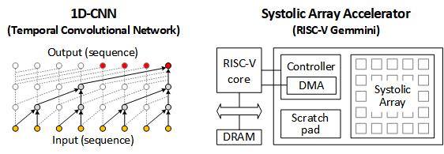

# Getting Started

## Overview
This repository contains essential software to run 1D-CNN model on systolic array attached to RISC-V CPU.
It contains elementary tensor arithmetric primitives such as GEMM, and 1D-CNN model (i.e., [Temporal Convolutional Network](https://arxiv.org/pdf/1803.01271.pdf)) implementation.

<p align="center">
  
</p>

## Prerequisite
This repository leverages i) RISC-V toolchains and ii) Spike, an RISCV ISA-level simulator.
Users need to install them before running CNN-RoCC-Acceleration.

```
# install conda (Chipyard's package manager)
wget "https://github.com/conda-forge/miniforge/releases/latest/download/Miniforge3-$(uname)-$(uname -m).sh"
bash Miniforge3-$(uname)-$(uname -m).sh

# install conda-lock
conda install -n base conda-lock=1.4
conda activate base

# install Chipyard
git clone https://github.com/ucb-bar/chipyard.git
cd chipyard
git checkout 1.9.1

# build riscv tools & spike
./build-setup.sh riscv-tools -s 5
source ./env.sh

# Setting up gemmini
cd generators/gemmini
git config remote.origin.fetch "+refs/heads/*:refs/remotes/origin/*"
git fetch && git checkout v0.7.1
git submodule update --init --recursive

make -C software/libgemmini install

./scripts/setup-paths.sh
./scripts/build-spike.sh
```

Check installation by running below
```
# make sure you setup your environment variables by running env.sh from Chipyard
spike pk --help
```

## Build
This repository leverages CMAKE for compilation.
Run your preferred routine for CMAKE. Or you can follow:
```
mkdir build
cmake .. [OPTIONS]
make -j N
```

You might want to use below option for your own purpose.
* MODE_VCU118
* MODE_VC707
* BUILD_INTERVAL_ONLY
* DEBUG_BUILD
* PROFILE
* SPIKE
* BAREMETAL
* NUM_BLOCKS
* MODE
* HIDDEN_FEATURES

## Run on Spike
Run this executable on Spike for faster test.
Note that Spike can only validate the functionality.
Performance statistics (e.g., cycle counts, SoC's performance counter values) are meaningless.
```
spike --extension=gemmini pk build/conv1d_test
spike --extension=gemmini pk build/dws_conv1d_test
spike --extension=gemmini pk build/tcnblock_test
spike --extension=gemmini pk build/stateful_conv1d_test
spike --extension=gemmini pk build/interval_time_model_test
```

## Run on RISC-V CPU
For the evaluation, you should run this program on RISC-V CPU.
You might want to build your own RISC-V CPU with [ours](https://camel.kaist.ac.kr/opensource/camel-risc-v-soc) on FPGA.

## Troubleshooting
* [Chipyard documentation](https://chipyard.readthedocs.io/en/latest/Chipyard-Basics/Initial-Repo-Setup.html)
* [Chipyard github](https://github.com/ucb-bar/chipyard)
